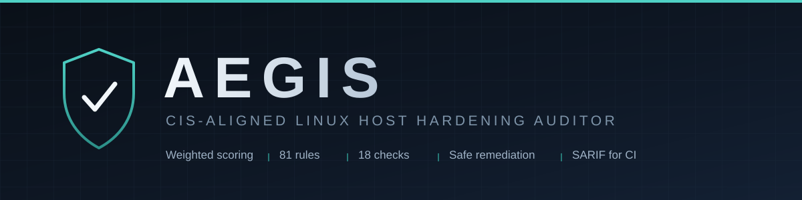
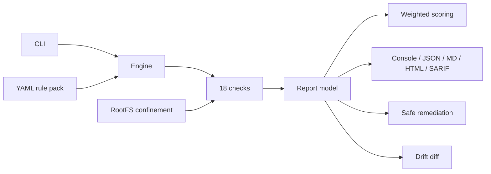

# aegis

[](https://github.com/dev-rudran/aegis-audit/actions/workflows/ci.yml)
[](LICENSE)
[](https://www.python.org/downloads/)
[](docs/architecture.md#reports)

aegis audits Linux hosts and filesystem images against a CIS-aligned rule pack,
scores the result by severity, and produces evidence that CI can consume. It is a
single dependency-light Python package with no daemon, no database, and no
network access.

- **81 rules** across SSH, kernel hardening, filesystem permissions, accounts,
  logging and auditd, firewall, package hygiene, services, and cryptography.
- **Weighted scoring** instead of a raw pass rate, with per-category breakdowns
  and letter grades.
- **Time-bound exceptions** so an accepted risk cannot silently become permanent.
- **Safe remediation**: dry-run by default, structured fixes only, backups and
  atomic replacement on `--apply`, and no shell execution.
- **Five report formats**, including a self-contained HTML file and valid
  SARIF 2.1.0 for code scanning.
- **Image auditing** through `--root`, with chroot-style symlink resolution that
  cannot escape the target tree.

## Installation

Python 3.10 or newer is required. The only runtime dependency is PyYAML.

```sh
python3 -m venv .venv
. .venv/bin/activate
python -m pip install .
aegis version
```

```
aegis 0.1.0 (report schema 1.0)
```

For development, install the test and lint toolchain with
`python -m pip install -e ".[dev]"`.

## Quick start

Audit the running host. The default gate fails on any critical finding and the
default report format is console.

```sh
aegis
```

To audit an image or an extracted container filesystem without touching the
host's own configuration:

```sh
aegis --root /mnt/image --fail-on high --min-score 80
```

The output below is a real run against a prepared copy of the hardened fixture
root that ships with the test suite:

```
$ aegis --root tests/fixtures/rootfs-hardened --no-color
aegis 0.1.0  Linux host hardening audit
Root: tests/fixtures/rootfs-hardened
Rules: 81   Generated: 2026-11-16T02:15:00Z   Duration: 8 ms

  Score  100.00 / 100    Grade A
  PASS 81   FAIL 0   ERROR 0   N/A 0   SUPPRESSED 0

Severity     Total   Pass   Fail  Error    N/A   Suppressed
CRITICAL               5      5      0      0      0            0
HIGH                  38     38      0      0      0            0
MEDIUM                35     35      0      0      0            0
LOW                    3      3      0      0      0            0

Category                    Score   Weight   Pass   Fail  Error    N/A
Accounts                    100.0   73/73       18      0      0      0
Crypto                      100.0   25/25        5      0      0      0
Filesystem                  100.0   55/55       10      0      0      0
Firewall                    100.0   15/15        3      0      0      0
Kernel                      100.0   33/33       14      0      0      0
Logging                     100.0   23/23        7      0      0      0
Packages                    100.0   19/19        5      0      0      0
SSH                         100.0   49/49       13      0      0      0
Services                    100.0   21/21        6      0      0      0

All evaluated controls passed.

Result: 0 failing, 0 error(s), 0 not applicable. Score 100.00 (A). Gate: PASS
```

The vulnerable fixture, which deliberately reproduces common misconfigurations,
scores very differently:

```
$ aegis --root tests/fixtures/rootfs-vulnerable --quiet
3.83 F failed=78 errors=0 gate=FAIL
```

The full report lists each failure with the observed value, the CIS reference,
an explanation, the remediation text, and an advisory command. A filtered run on
one category is often the fastest way to review a change:

```
$ aegis --root tests/fixtures/rootfs-vulnerable --category Firewall --no-color
aegis 0.1.0  Linux host hardening audit
Root: tests/fixtures/rootfs-vulnerable
Rules: 3   Generated: 2026-11-16T02:17:28Z   Duration: 0 ms

  Score  0.00 / 100    Grade F
  PASS 0   FAIL 3   ERROR 0   N/A 0   SUPPRESSED 0

Severity     Total   Pass   Fail  Error    N/A   Suppressed
HIGH                   3      0      3      0      0            0

Category                    Score   Weight   Pass   Fail  Error    N/A
Firewall                      0.0    0/15        0      3      0      0

Top risks
  1. HIGH AEGIS-0067  The UFW host firewall is not enabled
     ufw enabled check failed: ENABLED='no' in /etc/ufw/ufw.conf
  2. HIGH AEGIS-0068  UFW default inbound policy is not deny
     ufw default_incoming check failed: DEFAULT_INPUT_POLICY='ACCEPT' in /etc/default/ufw
  3. HIGH AEGIS-0069  No supported host firewall is enabled
     no supported host firewall satisfies enabled

Findings

Firewall
  [FAIL] AEGIS-0067  The UFW host firewall is not enabled
         HIGH | Firewall | CIS Ubuntu Linux 22.04 3.5.1.2
         ufw enabled check failed: ENABLED='no' in /etc/ufw/ufw.conf
         fix: Enable UFW after confirming management access will not be locked out.
         command: ufw --force enable
```

## Scoring and gates

Weights are critical 10, high 5, medium 2, low 1, and info 0. The score is
`100 * passed_weight / evaluated_weight`; not-applicable rules and suppressed
exceptions are excluded from both sides. Grades are A at 90, B at 80, C at 70,
D at 60, and F below.

| Flag | Default | Effect |
| --- | --- | --- |
| `--fail-on critical` | Yes | Exit 1 when a finding at or above the threshold exists. |
| `--fail-on never` | | Disable the severity gate; the score gate still applies. |
| `--min-score N` | Unset | Exit 1 when the weighted score is below N. |

| Exit code | Meaning |
| --- | --- |
| 0 | Audit completed and the gate passed |
| 1 | Audit completed and the gate failed, or a diff regressed |
| 2 | Usage error, invalid rule pack, missing baseline, or runtime failure |

`--quiet` prints one machine-friendly status line and any gate reasons, which is
convenient in scripts:

```
$ aegis --root tests/fixtures/rootfs-vulnerable --fail-on never --min-score 90 --quiet
3.83 F failed=78 errors=0 gate=FAIL
$ echo $?
1
```

## Reports

| Format | Flag | Use |
| --- | --- | --- |
| Console | `-f console` | Interactive review, colour by default |
| JSON | `-f json` | Automation, artifact retention, `aegis diff` |
| Markdown | `-f md` | Pull request comments, wikis |
| HTML | `-f html` | Self-contained evidence file with inline CSS |
| SARIF | `-f sarif` | GitHub code scanning and SARIF viewers |

The format is inferred from the output extension when `-f` is omitted, so
`-o report.sarif.json` produces SARIF and `-o report.md` produces Markdown. A
single `-` output path means stdout. Diagnostics such as the remediation plan
always go to stderr, keeping piped JSON and SARIF clean.

Markdown output begins with a summary and category table:

```markdown
# aegis hardening report

- **Root:** `tests/fixtures/rootfs-vulnerable`
- **Generated:** 2026-11-16T02:17:33Z
- **aegis version:** 0.1.0
- **Rule set:** 78a986c2fb7c116e

## Score

**3.83 / 100 - grade F**

3 passed, 78 failed, 0 errors, 0 not applicable, 0 suppressed.

| Severity | Total | Pass | Fail | Error | N/A | Suppressed |
| --- | ---: | ---: | ---: | ---: | ---: | ---: |
| critical | 5 | 0 | 5 | 0 | 0 | 0 |
| high | 38 | 2 | 36 | 0 | 0 | 0 |
| medium | 35 | 1 | 34 | 0 | 0 | 0 |
| low | 3 | 0 | 3 | 0 | 0 | 0 |
```

SARIF uses stable rule IDs, maps severity to result levels, carries the CIS
reference and remediation text in rule metadata, and emits repository-relative
artifact locations for code scanning. One result looks like this:

```json
{
  "ruleId": "AEGIS-0042",
  "ruleIndex": 0,
  "level": "error",
  "message": {
    "text": "multiple UID 0 accounts exist: root, toor (CIS CIS Ubuntu Linux 22.04 6.2.3)"
  },
  "properties": {
    "severity": "critical",
    "category": "Accounts",
    "cis": "CIS Ubuntu Linux 22.04 6.2.3",
    "status": "fail",
    "suppressed": false,
    "evidence": {
      "uid_zero_accounts": ["root", "toor"]
    }
  },
  "partialFingerprints": {
    "aegisFinding/v1": "524e482ff923789f459cf6882d778ad1"
  },
  "locations": [
    {
      "physicalLocation": {
        "artifactLocation": { "uri": "etc/passwd" },
        "region": { "startLine": 1, "startColumn": 1 }
      }
    }
  ]
}
```

The HTML report is a single file with no external assets, suitable for attaching
to a change record or opening from an artifact store.

## Drift between runs

Store JSON reports as build artifacts and compare any two of them:

```sh
aegis diff reports/vulnerable.json reports/hardened.json
```

```
aegis drift report
Old: score 3.83 (F)   New: score 100.00 (A)   Delta: +96.17
Newly failing: 0   Still failing: 0   Newly fixed: 78

Severity      Newly failing   Still failing   Newly fixed
critical                  0               0             5
high                      0               0            36
medium                    0               0            34
low                       0               0             3
info                      0               0             0
```

Each section can be printed as text or JSON. `aegis diff` exits 1 when the new
report regresses, so a scheduled audit fails the job when posture drops;
`--allow-regression` reports the drift without failing.

## Safe remediation

Rules that declare `remediation.safe: true` also carry a structured fix of type
`file_mode`, `file_content`, `sshd_set`, or `sysctl_set`. `--remediate` prints a
plan and writes nothing:

```
$ aegis --root tests/fixtures/rootfs-vulnerable --remediate
Remediation plan (dry run): 33 change(s), 0 already compliant, 0 failed, 45 manual control(s)
  WOULD_APPLY  AEGIS-0002  [critical] SSH root login is permitted
    target: /etc/ssh/sshd_config
    update PermitRootLogin no in /etc/ssh/sshd_config
    --- /etc/ssh/sshd_config
    +++ /etc/ssh/sshd_config
    @@ -1,5 +1,5 @@
     # aegis vulnerable fixture
     Port 22
    -PermitRootLogin yes
    +PermitRootLogin no
     PasswordAuthentication yes
     PermitEmptyPasswords yes
...
Manual remediation required for 45 control(s): AEGIS-0042, AEGIS-0043, AEGIS-0044, AEGIS-0045, AEGIS-0047, AEGIS-0050, AEGIS-0059, AEGIS-0013, and 37 more. Run 'aegis explain ID' for guidance.
```

`--apply` applies the safe subset, writes a `.aegis.bak` backup beside each
modified file, replaces files atomically, and then re-audits the post-fix state:

```
$ cp -r tests/fixtures/rootfs-vulnerable /tmp/aegis-demo
$ aegis --root /tmp/aegis-demo --apply
...
Re-audited after 33 applied fix(es): score 3.83 (F) -> 41.53 (F)
Manual remediation required for 45 control(s): AEGIS-0042, AEGIS-0043, AEGIS-0044, AEGIS-0045, AEGIS-0047, AEGIS-0050, AEGIS-0059, AEGIS-0013, and 37 more. Run 'aegis explain ID' for guidance.
```

The remaining 45 controls are manual by design: they need human judgement, a
service reload, or a package operation. Running `--apply` again produces zero
changes; the suite asserts this idempotence. Commands shown in reports are
advisory text and are never executed by aegis.

## Baseline exceptions

Accepted risks belong in a baseline file. Every entry needs a reason and an
expiry date; expired entries are reported as stale and suppress nothing.

```yaml
exceptions:
  - id: AEGIS-0067
    reason: Edge firewall enforces ingress filtering; host firewall pending change window
    expires: 2026-12-31
  - id: AEGIS-0003
    reason: Legacy jump host has no key distribution yet
    expires: 2026-01-15
```

```sh
aegis --root tests/fixtures/rootfs-vulnerable \
  --baseline baseline.yml --category Firewall --no-color
```

```
Stale baseline exceptions (not suppressing)
  AEGIS-0003  expired on 2026-01-15; not suppressed

Baseline: 1 finding(s) suppressed, 1 expired, 0 unused.
```

Suppressed findings remain in JSON and SARIF with a suppression marker, so
downstream tooling can distinguish accepted risk from a passing control.

## Rule tooling

```sh
aegis rules list
aegis rules show AEGIS-0002
aegis rules validate
aegis explain AEGIS-0067
```

```
$ aegis rules validate
Rule pack valid: 81 rules from 10 file(s) in /home/rudra/Projects/Github/aegis-audit/src/aegis/rules
Categories: Accounts, Crypto, Filesystem, Firewall, Kernel, Logging, Packages, SSH, Services
Check types exercised: 17 of 18 registered
```

```
$ aegis explain AEGIS-0067
AEGIS-0067  The UFW host firewall is not enabled
Severity: high (weight 5)   Category: Firewall   CIS: CIS Ubuntu Linux 22.04 3.5.1.2

Description
  A host firewall limits inbound exposure to services that are intentionally published. UFW must
  be enabled for its default policy to take effect.

Check
  type: firewall
  params:
    engine: ufw
    setting: enabled

Remediation
  Enable UFW after confirming management access will not be locked out.
  safe automatic fix: no
  command: ufw --force enable

Tags: firewall, ufw
```

`--rules-dir` loads a custom pack. `aegis rules validate` checks every document,
including check parameters and structured fixes, before an audit can run.

## Rule coverage

| Category | Rules | Focus |
| --- | ---: | --- |
| SSH | 13 | Authentication policy, access restriction, banner, weak algorithms |
| Kernel | 14 | ASLR, forwarding, redirects, SYN cookies, module blacklists, core dumps |
| Filesystem | 10 | Sensitive file modes, cron permissions, mount options, world-writable files |
| Accounts | 18 | UID 0, shadowed passwords, password aging, pwquality, login.defs, umask |
| Logging | 7 | auditd configuration and enablement, journald persistence, log modes |
| Firewall | 3 | UFW state, default policy, and a combined host-firewall control |
| Packages | 5 | Legacy network servers, xinetd, automatic security updates |
| Services | 6 | Enabled legacy sockets, cron enablement, listening clear-text ports |
| Crypto | 5 | SSH ciphers, MACs, key exchange, OpenSSL minimum protocol, password hashing |

The full catalogue, including CIS references, check parameters, and remediation
guidance for every rule, is in [`docs/RULES.md`](docs/RULES.md). The pack
contains 35 rules with an automated safe fix and 46 manual controls.

## Architecture



All reads go through `RootFS`, which resolves absolute symlinks relative to the
audit root, rejects traversal, caps reads at 4 MiB, and bounds directory walks.
Checks never execute commands and never open a network connection. See
[`docs/architecture.md`](docs/architecture.md) for the module map, data flow,
scoring details, and the remediation safety model.

## CI integration

```yaml
name: Host hardening
on:
  schedule:
    - cron: "0 6 * * 1"
  workflow_dispatch:

jobs:
  audit:
    runs-on: ubuntu-latest
    steps:
      - uses: actions/checkout@v4
      - uses: actions/setup-python@v5
        with:
          python-version: "3.12"
      - run: python -m pip install .
      - run: aegis --fail-on high --min-score 80 -f sarif -o aegis.sarif
      - uses: github/codeql-action/upload-sarif@v3
        if: always()
        with:
          sarif_file: aegis.sarif
```

The process exits 1 on a gate failure and 2 on a usage or runtime error, so a
broken rule pack is distinguishable from a failed audit.

## Development

```sh
make venv     # create .venv and install with dev extras
make check    # ruff check, ruff format --check, bandit, pytest
make docs     # regenerate docs/RULES.md from the rule pack
```

The suite covers the check library, rule validation, scoring, baselines, diffing,
remediation idempotence, every reporter, and the CLI end to end. See
[`CONTRIBUTING.md`](CONTRIBUTING.md) for the rule and check authoring workflow.

## Roadmap

- Live-state verification for kernel modules, sysctl, and firewall rules when
  running against the current host.
- Additional distribution layouts for package and service metadata.
- Severity overrides and rule enablement profiles per host role.

## Limitations

- Checks inspect persisted configuration under the audit root. Kernel modules
  and sysctls are evaluated as they will be applied at boot, not as they are
  currently loaded.
- Package, service, and firewall checks understand common Debian/Ubuntu and
  RHEL-family layouts; unusual layouts produce findings that need review.
- Ownership checks are implemented and tested but not used by the bundled pack,
  because fixture ownership cannot be changed without root.
- aegis does not verify the integrity of the host it runs on. Run it from a
  trusted management environment.

## Documentation

- [`docs/RULES.md`](docs/RULES.md): every rule, check, severity, and fix type.
- [`docs/architecture.md`](docs/architecture.md): modules, data flow, safety
  model, and extension points.
- [`SECURITY.md`](SECURITY.md): threat model and vulnerability reporting.
- [`CONTRIBUTING.md`](CONTRIBUTING.md): development setup and review standards.
- [`CHANGELOG.md`](CHANGELOG.md): release history.

## License

MIT. See [`LICENSE`](LICENSE).
