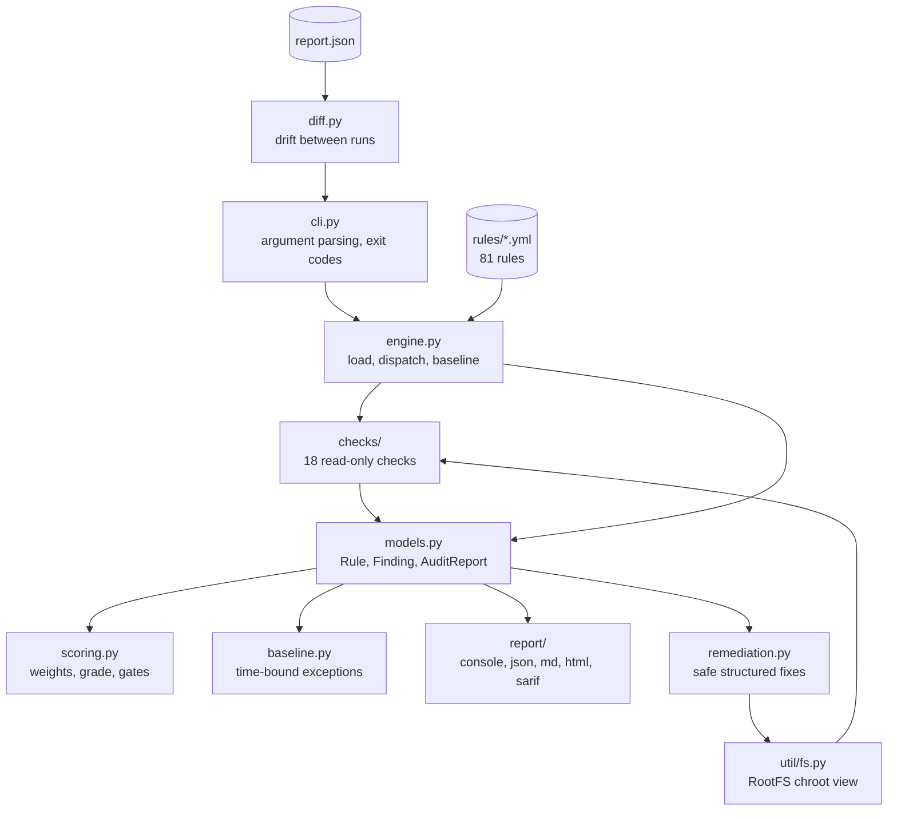

# Architecture

aegis is a read-only scanner with an optional, narrowly scoped writer. The audit
path never mutates a host; the remediation path only rewrites files that a rule
explicitly marks safe. Everything is driven by a declarative YAML rule pack, so
adding coverage does not require new Python.

## Component map



## Module responsibilities

| Module | Responsibility |
| --- | --- |
| `cli.py` | Parses arguments, selects rules and report format, applies gates, runs remediation, dispatches subcommands. The only module that calls `sys.exit`. |
| `engine.py` | Loads and validates the rule pack, builds a `RootFS`, runs checks with a shared cache, applies the baseline, and assembles an `AuditReport`. |
| `models.py` | Frozen-enough dataclasses for rules and findings, plus the versioned JSON round-trip used by `diff` and integrations. |
| `scoring.py` | Severity weights, weighted score, grade thresholds, per-severity and per-category aggregation, top-risk selection, gate evaluation. |
| `baseline.py` | Parses YAML exceptions, validates expiry dates, marks matching findings suppressed, and reports stale entries. |
| `diff.py` | Compares two serialized reports: newly failing, newly fixed, still failing, severity counts, score delta. |
| `remediation.py` | Plans and applies structured fixes. Owns backups, atomic replacement, diff generation, and idempotence. |
| `checks/` | One module per domain (files, ssh, accounts, system, network, logging) plus a registry with validators and runners. |
| `report/` | Five renderers. `json_report.py` defines the public machine format; SARIF maps findings to code-scanning results. |
| `util/fs.py` | The only filesystem access layer. Enforces the audit root, size limits, symlink policy, and bounded traversal. |
| `util/shell.py` | Parsers for passwd, shadow, group, fstab, mountinfo, and package databases. No subprocess execution. |
| `util/text.py` | Small parsing helpers for integers, booleans, lists, and assignment-style configuration files. |

## Audit data flow

1. `cli.py` resolves the audit root, rule directory, filters, baseline, and gate options.
2. `engine.load_rules` reads every `*.yml`, validates required fields, check parameters, tags, and structured fixes, and rejects the whole pack on the first invalid document instead of silently skipping controls.
3. `engine.audit` constructs `RootFS(root)` and a `CheckContext` with a per-run cache, then runs each selected rule. A check exception becomes an `ERROR` finding rather than aborting the run, so one malformed host file cannot hide the rest of the posture.
4. `baseline.apply` suppresses matching failures whose exception has not expired; expired entries are reported separately and suppress nothing.
5. `scoring.apply_scoring` computes weights, score, grade, category breakdown, severity statistics, and top risks.
6. `cli.py` evaluates the gate and renders the report through `report/__init__.py`.

## Filesystem confinement

All host reads go through `RootFS`. It normalizes paths, rejects `..` traversal,
and resolves symlinks with chroot semantics: an absolute target such as
`/etc/ssh/sshd_config` resolves to `<root>/etc/ssh/sshd_config`, not the host's
file. Relative targets resolve against their link directory. Resolution is
bounded by depth and fails closed on loops.

This is what makes `--root /mnt/image` safe on a build server. It also means
ownership checks resolve UID and GID against the root's own `passwd` and `group`
databases, not the host's.

Reads are capped at 4 MiB per file. Directory walks are bounded and ignore
`/proc`, `/sys`, and `/dev` where appropriate. Reporters never read the
filesystem; they render from the report model.

## Check contract

Every check implements two functions: a validator that collects every parameter
problem, and a runner that returns a `CheckResult` with a status, a human
message, and optionally a normalized line reference.

Validators run during rule loading, so `aegis rules validate` can catch a typo
in a custom pack before it is used. Runners do not raise for host conditions;
missing files, unreadable paths, and malformed configuration become `FAIL` or
`ERROR` findings with an explanation.

Registered check types: `file_exists`, `file_mode`, `file_owner`,
`file_content`, `sysctl`, `sshd`, `package`, `service`, `account`,
`mount_option`, `firewall`, `kernel_module`, `login_defs`, `auditd`,
`cron_permissions`, `world_writable`, `listening_port`, `password_quality`.

## Scoring

Every evaluated finding adds its severity weight (critical 10, high 5, medium 2,
low 1, info 0) to the denominator and a passing finding adds the same weight to
the numerator. `not_applicable` and suppressed findings are excluded from both.
A run with no evaluated weight scores 100 rather than dividing by zero.

Grades are A at 90, B at 80, C at 70, D at 60, and F below. Category scores use
the same formula within each category. Top risks are ordered by severity, then
rule ID, and capped so the summary stays readable.

## Gates and exit codes

The default gate fails on any critical finding. `--fail-on` moves the threshold,
`--min-score` adds a score floor, and `--fail-on never` disables the severity
gate while leaving the score gate active. Exit codes are stable for CI:

| Code | Meaning |
| --- | --- |
| 0 | Audit completed and the gate passed |
| 1 | Audit completed and the gate failed |
| 2 | Usage error, invalid rule pack, unreadable baseline, or runtime failure |

`diff` exits 1 when the new report regresses, unless `--allow-regression` is set.

## Remediation safety model

Remediation is deliberately narrow. A rule can only be applied when it declares
`remediation.safe: true` and a structured `fix` block of type `file_mode`,
`file_content`, `sshd_set`, or `sysctl_set`. The command text in the rule pack is
advisory output; aegis never executes it.

The plan phase computes a before/after diff without writing. With `--apply`,
each change:

1. resolves the target through the same `RootFS` confinement used for reads;
2. copies the original to `<file>.aegis.bak` the first time it is modified;
3. writes to a temporary file in the same directory, `fsync`s it, and replaces
   the target atomically;
4. records the before value, after value, and unified diff for the report.

A second `--apply` on an already compliant host produces zero changes, which is
asserted by the test suite. Fixes that cannot be planned, such as a target that
does not exist, are reported as failed rather than guessed at.

## Baselines

A baseline is a YAML document of exceptions:

```yaml
exceptions:
  - id: AEGIS-0003
    reason: Key-only access is enforced by the bastion, password auth is disabled upstream
    expires: 2026-12-31
```

Entries without an expiry are rejected: exceptions must be time bound. Expired
entries are reported as stale and never suppress a finding. Suppressed findings
remain in JSON and SARIF with a suppression marker so downstream tooling can
distinguish "known and accepted" from "passing".

## Reports

| Format | Consumer | Notes |
| --- | --- | --- |
| console | Humans, terminal | ANSI colour by default, disabled with `--no-color` or when not a TTY; honours `NO_COLOR`. |
| json | Automation, `diff` | Versioned schema (`schema_version`), full rule and remediation metadata. |
| md | Pull requests, wikis | Summary tables plus failing findings grouped by category. |
| html | Attachments, evidence | One self-contained file, no external assets, inline CSS only. |
| sarif | GitHub code scanning, other SARIF consumers | SARIF 2.1.0, stable rule IDs, help URIs, suppression metadata. |

Format is inferred from the `-o` extension when `-f` is omitted, so
`-o report.sarif.json` produces SARIF and `-o report.md` produces Markdown.
Diagnostics such as the remediation plan always go to stderr so machine-readable
stdout stays clean.

## Extension points

- **New control:** add a rule to the relevant file in `src/aegis/rules/` using an
  existing check. Run `aegis rules validate` and `make docs`.
- **New check type:** implement `run_*` and `validate_*` in `checks/`, register a
  `CheckSpec` in `checks/__init__.py`, then add a unit test for both functions.
- **New report format:** add a renderer in `report/`, register it in `FORMATS`,
  and extend the CLI choices and output-extension inference.

## Deliberate limits

aegis audits configuration files and package metadata inside a filesystem root.
It does not boot the host, query a live kernel, enumerate kernel modules with
`lsmod`, or attach to a running firewall. `sysctl` and `kernel_module` checks
therefore reason about persisted configuration, which is what a reboot will
enforce. Live-state verification remains a job for the host's own tooling and is
called out in each rule's command hint.
